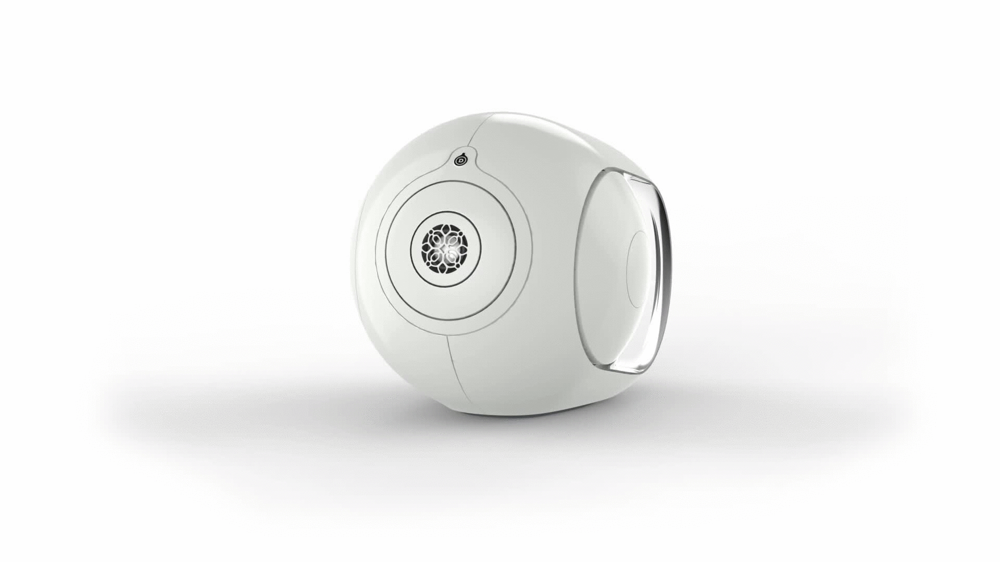
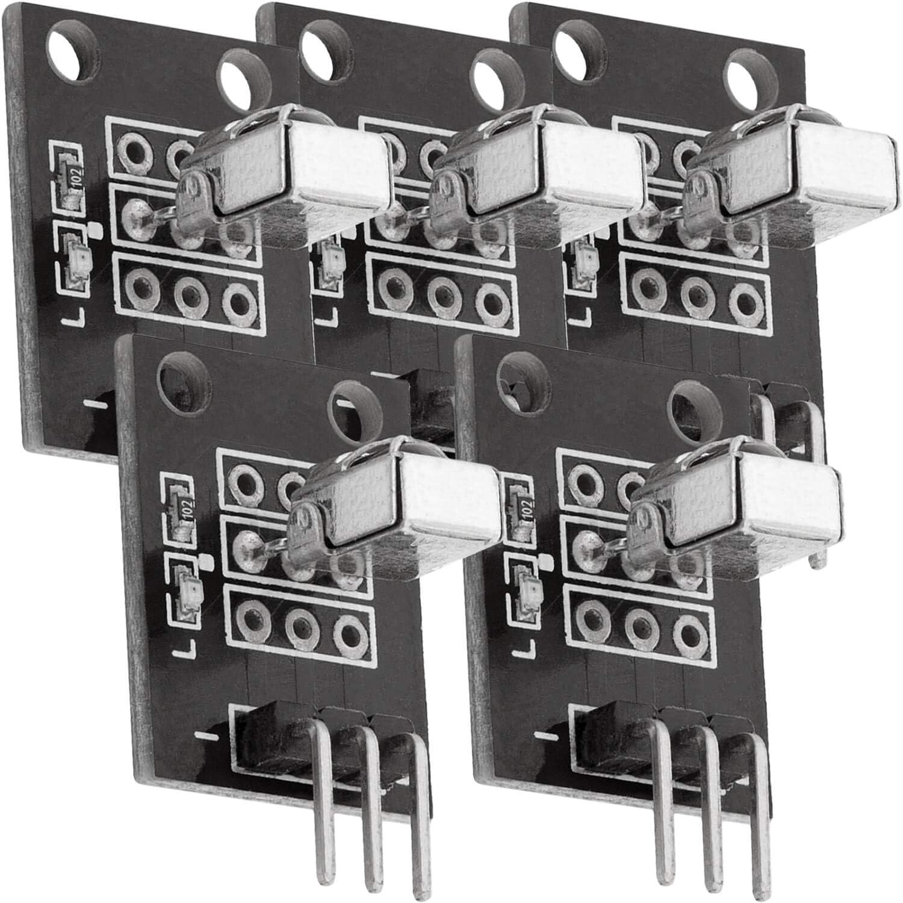
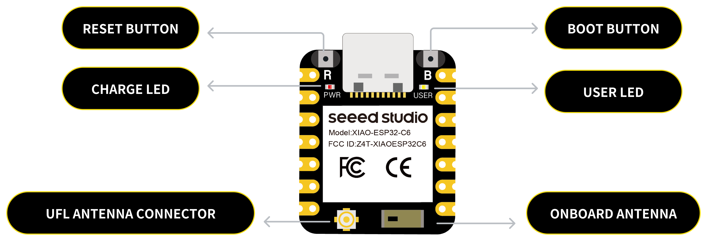

# devialet-ir

An ESP32 IR receiver to control the volume of Devialet speakers, integrated with Home Assistant.

<p align="center">
  </img>
</p>

The volume keys of a TV remote are decoded by an IR receiver and turned into [Devialet IP Control](./Devialet%20IP%20Control%20-%20R1.pdf) requests, so a Phantom speaker can be controlled from the remote (here, an Apple TV Siri Remote driving an LG TV).
Every key press is also sent to Home Assistant, where it can trigger any automation.

The firmware is now an [ESPHome](https://esphome.io) configuration: [`esphome/devialet-ir.yaml`](./esphome/devialet-ir.yaml).
The original Arduino/PlatformIO firmware is **deprecated** but kept in the repository: see [README.arduino.md](./README.arduino.md).

## Why we moved to ESPHome

The first version was a hand-written Arduino sketch built with PlatformIO. It worked, but:

- **The toolchain was fragile.** The ESP32-C6 was barely supported: the build needed the Tasmota fork of the PlatformIO platform and a C++20 branch of IRremoteESP8266. ESPHome supports the C6 directly and ships its own IR decoding.
- **There was no Home Assistant integration.** The device only talked to the speaker. Adding Home Assistant would have meant writing MQTT or an HTTP API, discovery, and reconnection handling by hand. ESPHome provides a native, encrypted Home Assistant API and auto-discovery.
- **Maintenance needed a USB cable.** Every change meant plugging the board into a computer. ESPHome updates over Wi-Fi.
- **Wi-Fi credentials lived in source code** (`src/secrets.hpp`), and a Wi-Fi failure needed a reflash. ESPHome keeps them in a git-ignored `secrets.yaml` and opens a fallback hotspot to fix them from a phone.
- **Some bugs were hard to see without logs or tests:** the volume request went to a relative URL, mute was sent without the JSON body the API requires, and mute could not toggle.

What we gained:

- Each key press appears in Home Assistant as an event (`volume_up`, `volume_down`, `mute`), usable for any automation.
- A **Direct speaker control** switch: when on, the device drives the speaker itself, so the remote keeps working even when Home Assistant is down; when off, Home Assistant handles the keys (for example through its built-in Devialet integration).
- About 280 lines of C++ became one YAML file.

What we gave up, knowingly:

- **Automatic speaker discovery.** The Arduino version found the Phantom over mDNS at boot. The ESPHome version uses a configured address (editable from Home Assistant), so reserve a DHCP lease for the speaker.
- **Some logic now lives in C++ snippets inside YAML** (key-hold handling, JSON parsing), which is less pleasant to edit than plain code.
- **The status LED means something else** (see [LED](#led)).

## Hardware

- A Seeed Studio XIAO ESP32C6 board ([official product page](https://wiki.seeedstudio.com/xiao_esp32c6_getting_started/))
- A KY-022 IR receiver ([the one used for the build](https://www.amazon.fr/dp/B07ZYZDW28))
- A Devialet Phantom (tested with a Phantom II 98 dB stereo pair)
- A remote sending NEC codes (tested with an LG TV remote and an Apple Siri Remote controlling the LG TV)

Connect the KY-022: **S** (signal) to **D10**, the middle pin to **3V3**, and **-** to **GND**.

<p align="center">
  </img>
</p>



## Flashing

```sh
pip install esphome
cd esphome
cp secrets.example.yaml secrets.yaml   # fill in Wi-Fi and keys (openssl rand -base64 32)
esphome run devialet-ir.yaml           # first time over USB-C, then over Wi-Fi
```

Set `speaker_address` in the `substitutions:` block to the IP of your Phantom, or change it later from Home Assistant.

> If the board refuses to be flashed: unplug it, hold the tiny **B** button next to the USB-C connector, and plug it back in while holding.
>
> On Linux, your user needs to be in the `dialout` group to access the USB serial port.

If the device can't join your Wi-Fi, it opens a `Devialet-IR Fallback` hotspot (password: `fallback_ap_password` in `secrets.yaml`) where you can enter new credentials.

## Home Assistant

The device is discovered automatically (Settings → Devices & services → ESPHome); use the `api_encryption_key` from `secrets.yaml` when asked. It exposes:

| Entity | Purpose |
| --- | --- |
| `event.devialet_ir_ir_command` | Fires `volume_up`, `volume_down` or `mute` on each key press |
| `switch.devialet_ir_direct_speaker_control` | ON: the ESP drives the speaker itself. OFF: only the event fires |
| `text.devialet_ir_speaker_address` | IP or host of the Phantom used for direct control |
| `sensor.devialet_ir_last_ir_code` | Last decoded NEC code, handy to map another remote |

Also add Home Assistant's built-in **Devialet** integration to get the Phantom as a media player.
To let Home Assistant handle the keys instead of the ESP, turn the direct control switch off and use
[`esphome/home-assistant-automation.example.yaml`](./esphome/home-assistant-automation.example.yaml).

## Behaviour

- A tap changes the volume by 2% (`volume_step`). Holding a key repeats after 400 ms, at most every 200 ms (`hold_delay_ms`, `hold_interval_ms`).
- Mute reads the speaker's current state and toggles it.

### Using another remote

Set `dump: all` under `remote_receiver:`, press the keys, read the codes in `esphome logs devialet-ir.yaml` (or the *Last IR code* sensor), and update the `switch (x.command)` block in `on_nec`.

## LED

The yellow LED is ESPHome's status LED: it blinks slowly on warnings (for example Wi-Fi or Home Assistant not connected), blinks fast on errors, and stays off when everything is fine.
This replaces the blink patterns of the Arduino version.
